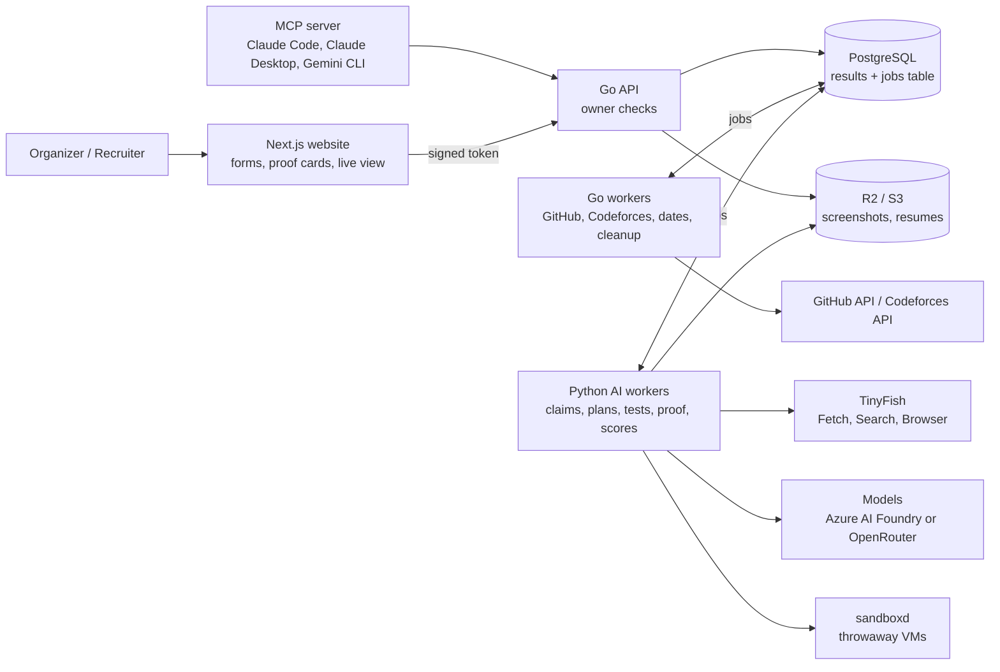
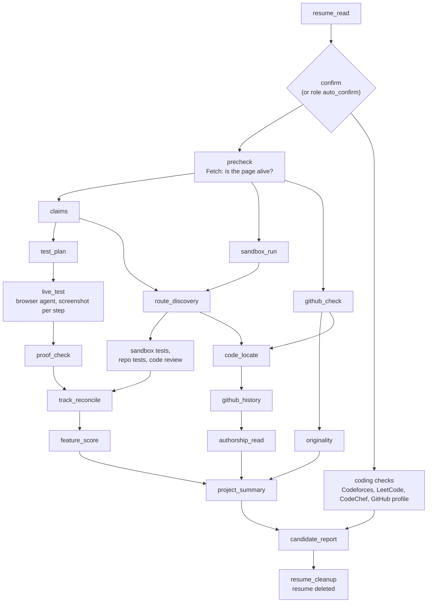

# TalNex

**Proof, not promises.** TalNex is an AI agent that opens a project's live link, uses it like a real person, and
shows a screenshot of every step.

Built for **HackIIITD** by team **Simpletons**.

```
Live link  ->  Agent tests it  ->  Proof card
```

---

## Contents

- [The problem](#the-problem)
- [What TalNex does](#what-talnex-does)
- [Three modes, one engine](#three-modes-one-engine)
- [Key features](#key-features)
- [How it works](#how-it-works)
- [Tech stack](#tech-stack)
- [Safety and honesty](#safety-and-honesty)
- [How we check TalNex itself](#how-we-check-talnex-itself)
- [Cost and speed](#cost-and-speed)
- [Quick start](#quick-start)
- [Repository layout](#repository-layout)
- [Testing](#testing)
- [Known limitations](#known-limitations)
- [Roadmap](#roadmap)
- [Team Simpletons](#team-simpletons)
- [Acknowledgements](#acknowledgements)

---

## The problem

A project link on a resume or a hackathon submission is a promise that nobody has time to check.

| Cost of checking by hand | |
|---|---|
| One project | 20–25 minutes |
| One candidate, after their projects | 30–40 minutes |

Why checking fails today:

1. **Demo videos can be faked.** A recording shows what the team chooses to show, not what the live app does.
2. **Live links can be broken.** The page may load while the core feature fails, or only a landing page exists.
3. **Coding profiles can be faked.** Codeforces, LeetCode and CodeChef records can be borrowed or inflated.
4. **Manual review does not scale.** Dozens of submissions, many minutes each. Claims go unchecked.

Resume filters, link checkers, code analyzers and fixed scripts exist. None of them tell you whether the app really
works.

## What TalNex does

An organizer or recruiter fills a form. TalNex then:

1. **Reads the claims.** What does the project say it does? (organizer criteria, the team's code, or resume bullets
   and the README)
2. **Plans the tests.** Each claim becomes the steps a real user would take, with the result they should see.
3. **Uses the live site.** A browser agent clicks, types and navigates, and saves a screenshot at every step.
4. **Issues a proof card** (hackathons) or a **proof report** (recruiters): what works, what does not, how sure we
   are, and why, with the screenshots.

An example proof card:

```
yourproject.app                              TalNex score  8.4 / 10   High confidence

  Works            Sign up and log in                      [screenshots]
  Works            Add an expense                          [screenshots]
  Works            Export to CSV                           [screenshots]
  Could not test   Payment checkout  (never pays on a live site; left out of the score)
```

Every verdict is one of **works**, **partly works**, **broken** or **could not test**. "Could not test" is left out
of the score, shows its reason, and never counts against anyone.

## Three modes, one engine

The checking engine is built once. Only the input and the report change.

| | Open-theme hackathon | Fixed-problem hackathon | Recruiter |
|---|---|---|---|
| **Who** | Organizer | Organizer | Recruiter |
| **Claims come from** | The features the team's code really implements | The organizer's weighted criteria (plus features found in the code) | Resume bullets, then the repository README |
| **You get** | A proof card per team, scores, flags, AI opinion, top 3 teams per feature | The same, with a labelled weighted total from your criteria | A proof report with a score out of 10 per feature, originality, GitHub and coding-profile signals, an interview kit |

Recruiters can check one resume, or create a **role** (a job opening with criteria and a role level) and upload many
resumes at once.

What TalNex commits to:

- Every number shows its proof.
- "Could not test" never counts against anyone.
- Red flags sit beside the score, never in it.
- No overall ranking and no winner. Humans decide.

## Key features

**Testing**

- **Live browser agent.** TalNex drives a real remote browser (TinyFish Browser, through Playwright) one action at a
  time and saves a screenshot after every action. Each claim's test can be played back as a clip with its verdict.
  Network calls and console messages are recorded per step.
- **Login ladder.** A legal way in, or it says so: a guest or demo button, then email sign-up with a TalNex inbox
  (AgentMail), then phone OTP with the team SIM and our SMS Relay app. Anything else is "could not test", with the
  exact reason.
- **Never-blame ladder.** Before a claim is marked broken, all four must hold: the page really loaded, it still fails
  after waiting about a minute, a second try built a different way also fails, and an independent check of the
  screenshots agrees. Otherwise the result is "could not confirm".
- **Independent proof check.** A separate model call sees only the screenshots and the expected result, never the
  first verdict. Both judges mark each check, and plain code decides the verdict. One judge never blames alone.
- **Repo sandbox track.** A repository is built and run in a fresh, time-limited sandbox (`sandboxd`), its backend
  routes are found and tested over HTTP, including bad input and edge cases. A project with only a repository still
  gets tested. AI parts of repo-only projects are reviewed from code, labelled so, and capped at 7/10.

**Scoring**

- **A score out of 10 per feature,** with a one-line reason and the checklist behind it. The score depends on the
  role level (fresher, junior, mid, senior).
- **The TalNex score** is the importance-weighted average of the scored features, shown out of 10 with **coverage**
  and **confidence**. Below 50% coverage it is shown greyed as "low coverage".
- **Flags beside the score, never subtracted.** Code pushed before the event, sponsor tools not really used, copying
  between teams, tutorial copy, hidden text aimed at an AI checker, secrets a live site leaks, and more.
- **Top 3 per feature.** "These teams built this feature best", never one best team.

**Who built it**

- **GitHub authorship and history.** For each claim, TalNex finds the code behind the feature and reads its history:
  which account wrote it, over how long, and when it arrived (against the event dates in hackathons).
- **GitHub profile.** Account age, original repos versus forks, commit patterns. Evidence, never a verdict.
- **Engineering quality.** Each submitted repository is also judged as engineering work.

**Coding profiles** (recruiter mode)

- **Codeforces** (official API): contests where every submission was skipped, and single skipped problems.
- **LeetCode** (public data, no login): voided contest results, and **Code Replay**: every paste in a contest
  solution, with its timing, checked against the code of nearby contestants.
- **CodeChef**, and a **LinkedIn** profile check.

**Watching and asking**

- **Live view.** Watch the remote browser while a project is tested, with one panel per project, or a live wall for a
  whole role. A mission control page is served by the API for local demos.
- **Jobs panel.** Every pipeline run as a clickable graph: see each stage's log, re-run chosen stages, retry a failed
  one.
- **Ask TalNex.** A chat on every report that answers only from the saved proof. It can suggest a re-test or a custom
  test, and nothing paid starts until a person presses the button.
- **Walkthroughs and guided tours.** Ask "walk me through the chatbot". TalNex answers from the code and the test
  results, with a file and line for every sentence. A guided tour shows it on the live site, step by step, beside the
  code.
- **Time and cost on every card.** Each check's run time and model cost are shown on the proof card and report.

**For developers**

- **MCP server** for Claude Code, Claude Desktop, Gemini CLI or any MCP client: 19 tools to create events, add teams,
  preview the cost, start a check, watch it live and read proof cards. Anything that spends money or deletes needs
  `confirm: true`.
- **API docs with a Try-it playground** at `/docs` on the website, generated from `backend/api/openapi.yaml`. A test
  fails if a route is missing from the spec.

## How it works

### Architecture

Three services and one database. **Go and Python never call each other.** They only pass work through the `jobs`
table in PostgreSQL. (The one exception: Python calls the `sandboxd` VM host through its client, like a vendor.)



- **The website** never touches the database or storage. It calls the Go API with a signed token.
- **The Go API** checks the owner on every request, so results are private to their owner.
- **The queue is Postgres.** Queue rules are database functions shared by both languages. The stage order is data
  (`pipeline_stages`): when a stage finishes, the worker saves its result and the next stages are added in the same
  database step. Every job is safe to run twice.
- **Files in storage, facts in Postgres.** Screenshots and resumes go to R2 (RustFS locally); the database keeps keys.

### Orchestration of one recruiter check

Each project runs **three tracks side by side**, and projects run in parallel.



- **Live track:** claims, test plan, live test, proof check, with the never-blame ladder before any "broken".
- **Sandbox track:** build and run the repository, find its routes, test them, run its own tests, review the code.
- **GitHub track:** repository checks, originality, and authorship per claim.
- `track_reconcile` makes the live site and the repository agree on a claim both tried, or the claim becomes "could
  not confirm". Then each feature is scored out of 10.
- The full stage table is in the website docs (`web/content/docs/orchestration.mdx`) and the design is in
  `docs/talnex_architecture.md`.

### How a verdict is decided

1. A claim is split into 1 to 4 **checks**, each quoting the claim's own words. Plain code rejects a plan that tests
   things the claim never said.
2. The run's judge and the blind screenshot check **both mark every check**: seen, not seen, cannot tell, or beyond
   the claim.
3. **Code decides.** A check is "not seen" only when both judges agree. A disagreement leaves the claim unconfirmed.
4. A test that ran out of time or actions is **tried once more**, built a different way, never marked down.

## Tech stack

| Part | Choice | Job |
|---|---|---|
| Website | Next.js 16, React 19, Auth.js (email + password, Google), Fumadocs, React Flow, Remotion | Forms, proof cards, live view, reports, docs |
| Backend | Go 1.27 | Public API, owner checks, job orchestration, GitHub and Codeforces APIs, migrations |
| AI workers | Python 3.10, Playwright, pdfplumber | Claims, test plans, live tests, proof checks, copy checks, scoring |
| Database | PostgreSQL 16 | All results, plus the job queue |
| File storage | Cloudflare R2 (RustFS locally) | Screenshots, resumes, LeetCode replays |
| Models | Azure AI Foundry or OpenRouter (one setting, `LLM_PROVIDER`) | Today: DeepSeek v4.1 Flash on Azure AI Foundry for every role |
| Web agent | TinyFish (Fetch, Search, Browser) | Is the page alive, web search, remote browser sessions |
| Browser fallback | Browserless (optional) | Keeps a live test running when TinyFish is unavailable |
| Sign-up inbox / phone | AgentMail / team SIM + our SMS Relay app (Expo) | Codes and links for the login ladder |
| Repo sandbox | `sandboxd` (Go), Docker driver | Builds and runs a repository in a fresh, time-limited VM |
| MCP server | TypeScript, Node 20+ | TalNex tools for AI assistants |
| Packaging | Docker Compose | Every service in its own container |

## Safety and honesty

| Rule | How |
|---|---|
| Never pay, delete or message real users | A safety preamble goes in front of every agent task; free text we type is labelled "TalNex test" |
| Page text is data, not orders | Page text, README text and code are wrapped as untrusted data in every prompt; hidden text aimed at an AI checker is flagged |
| Run limits | 3 tries per claim, 30 agent runs per project, counted in the database so a restart cannot reset them |
| Never blame by mistake | The four-step never-blame ladder before "broken"; "could not test" is left out of the score |
| Human confirm before paid runs | The recruiter confirms the projects found before checks start; MCP tools that spend money need `confirm: true` |
| Results private to the owner | The Go API checks the owner on every request; files are shared only as short-lived view links |
| Resume deletion (India DPDP Act 2023) | `resume_cleanup` deletes the resume after the report is built. Only results stay |
| Secrets stay secret | Settings come from the environment only; passwords for test sign-ups are derived per site and never stored |
| Sandbox limits | Every VM is fresh per run, has time and resource limits, holds no TalNex keys, and is removed by a reaper |

Two honest notes: on hosted Browserless `/stealth` the runner can solve a CAPTCHA, and the LinkedIn check logs in to
the team LinkedIn account. Neither is used on the default TinyFish path.

## How we check TalNex itself

We built and deployed our own **planted apps**, each with a known answer, and run every one 3 times through a gate:

```bash
python -m talnex_ai.worker.evaluate --all --runs 3 --project
```

The gate checks: no wrong verdicts ("could not test" is never wrong), the same verdict in at least 2 of 3 runs, the
TalNex score moves 10 points or less, and no unexpected red flags. AGENTS.md requires it to pass before any change to
testing, scoring, flags or prompts is merged.

| Planted app | What is planted |
|---|---|
| TinyTools (`talnex-honest`) | Every real claim works |
| CaptionIt (`talnex-fake-claim`) | The pages work, but no caption is ever written |
| NoteBox (`talnex-partly-works`) | Pinning does nothing, an empty title is accepted, the counter ignores deletes |
| ShelfMate (`talnex-shelfmate`) | Six features work; the CSV export and the reading goal bar do not |
| QuickKit (`talnex-copier-trickster`) | A renamed copy of TinyTools with hidden text aimed at AI reviewers |
| Bookmark, Expense and Task APIs | Repo-only backends with planted validation and logic bugs (sandbox track) |
| Login lab | 6 login types, 4 versions each, for the login ladder |

**Round 3 of the harness redesign** (5 live apps, 3 runs each):

| App | Right | Wrong | Could not test |
|---|---|---|---|
| TinyTools | 23 of 24 | 0 | 1 |
| QuickKit | 23 of 24 | 0 | 1 |
| CaptionIt | 13 of 18 | 0 | 5 |
| NoteBox | 11 of 15 | 0 | 4 |
| ShelfMate | 20 of 27 | 1 | 6 |
| **Total** | **90 of 108** | **1** | **17** |

- Before the redesign, TinyTools scored with 2 wrong verdicts. After it, 24 of 24 in round 2.
- The one wrong verdict: a ShelfMate claim (edit or delete a book) that should work; two runs could not test it and
  one said "partly works".
- The gate does not pass on every app yet: CaptionIt, NoteBox and ShelfMate still have too many "could not test".
- Reports are in `eval/report/`, expected answers in `eval/expected/`, raw runs in `eval/runs/`. The saved
  `eval/report/summary.md` is a later, cheaper run with model-free simple steps (67 right, 2 wrong, 39 could not test).

## Cost and speed

Measured on the demo resume (one candidate, four projects):

| | |
|---|---|
| Time | about 9–12 minutes |
| Cost | about $0.42–0.48 |
| Model calls | about 450–510 |
| Browser sessions | about 30 |

How we keep it low:

- **Fetch first.** TinyFish Fetch is free, so a browser session is opened only when the page is alive.
- **Our own step loop on TinyFish Browser.** A remote browser session costs about $0.002 a minute, over 100 times
  cheaper than an agent API for the same task. Every session is closed when done.
- **Budget guard.** A spend cap per TinyFish key, and a pool of keys.
- **Simple steps without the model.** "Type 'milk' into the search box" runs as a direct browser action; the model is
  asked only when that fails.
- **Parallel.** Projects and their three tracks run side by side; scale with `docker compose up -d --scale ai-worker=3`.
- **Logged.** Every model call writes its model, time and cost to `usage_log`, which is how each card shows its cost.

## Quick start

**Prerequisites:** Docker Desktop. Node 20+ only if you want the MCP server.

1. **Clone and configure.**

   ```bash
   git clone https://github.com/Abhay030405/Talnex-HACKIIITD.git
   cd Talnex-HACKIIITD
   cp .env.example .env
   ```

   Fill these settings in `.env` (the rest have working defaults):

   | Setting | What to put |
   |---|---|
   | `AUTH_SECRET` | Any long random string (shared by the website and the API) |
   | `SANDBOXD_TOKEN` | Any long random string (guards the sandbox VM host) |
   | `LLM_PROVIDER` | `azure_foundry` or `openrouter` |
   | `AZURE_FOUNDRY_ENDPOINT`, `AZURE_FOUNDRY_API_KEY`, `AZURE_FOUNDRY_MODEL`, `AZURE_FOUNDRY_PRICE_IN_PER_M`, `AZURE_FOUNDRY_PRICE_OUT_PER_M` | Your Azure AI Foundry deployment (if `azure_foundry`) |
   | `OPENROUTER_API_KEY` | Your OpenRouter key (if `openrouter`) |
   | `TINYFISH_API_KEY` (or `TINYFISH_API_KEYS`) | Your TinyFish key(s) |
   | `GITHUB_TOKEN` | A GitHub token for the GitHub API |

   Optional: `AGENTMAIL_API_KEY`, `AGENTMAIL_INBOX` and `EMAIL_LOGIN_SECRET` (email sign-ups on tested sites);
   `GOOGLE_CLIENT_ID` and `GOOGLE_CLIENT_SECRET` (Google sign-in); `TEAM_PHONE_NUMBER`, `SMS_GATEWAY_URL` and
   `SMS_GATEWAY_KEY` (phone OTP); `BROWSERLESS_CDP_URL` and `BROWSERLESS_TOKEN` (browser fallback);
   `LINKEDIN_EMAIL` and `LINKEDIN_PASSWORD` (LinkedIn check). Every setting has a one-line comment in `.env.example`.
   Never commit `.env`.

2. **Start everything.**

   ```bash
   docker compose up --build
   docker compose run --rm migrate     # applies database migrations (also runs on start)
   ```

3. **Open http://localhost:3000.** With `ENABLE_DEV_LOGIN=true` (the default) you can sign in with just an email
   locally, or create an email and password account.

### Try the demo resume

`testdata/resumes/demo_resume.pdf` lists four projects that are our planted apps on Vercel:

| Project | Live site |
|---|---|
| TinyTools | https://talnex-honest.vercel.app |
| ShelfMate | https://talnex-shelfmate.vercel.app |
| NoteBox | https://talnex-partly-works.vercel.app |
| CaptionIt | https://talnex-fake-claim.vercel.app |

1. Sign in as a **recruiter** and start a new candidate check.
2. Upload `testdata/resumes/demo_resume.pdf`.
3. Confirm the projects and coding profiles TalNex found. This starts the paid run.
4. Open the live view to watch the browser, then read the proof report when it finishes (about 10 minutes).

### Connect the MCP server

```bash
cd mcp
npm install
npm run build
claude mcp add talnex \
  --env TALNEX_API_URL=http://localhost:8080 \
  --env AUTH_SECRET=<AUTH_SECRET from .env> \
  --env TALNEX_EMAIL=organizer@example.com \
  --env TALNEX_ROLE=organizer \
  -- node <path to repo>/mcp/dist/index.js
```

Type `/mcp` in Claude Code: `talnex` should show 19 tools. Claude Desktop and Gemini CLI setups are in
`mcp/README.md`. Signing with `AUTH_SECRET` is for your own local stack only.

### Useful local pages

| Page | Address |
|---|---|
| Website | http://localhost:3000 |
| Docs, API reference and Try-it playground | http://localhost:3000/docs |
| Go API | http://localhost:8080 |
| Mission control (needs `ENABLE_DEV_ENDPOINTS=true`) | http://localhost:8080/v1/dev/live/view |

The optional Browserless container (`docker compose --profile browser up -d`) also uses host port 3000, so change
`WEB_PORT` before starting it.

## Repository layout

The folder structure is fixed (see `AGENTS.md`, section 4). A new sub-folder gets one line here in the same change.

| Folder | What goes here |
|---|---|
| `/` (root) | Only `README.md`, `AGENTS.md`, `CLAUDE.md`, `.env.example`, `.gitignore`, `.dockerignore`, `docker-compose.yml` (and your own `.env`, never committed) |
| `docs/` | `talnex_architecture.md` (the source of truth), `implementation_plan.md`, `harness_handoff.md`, `live_events.md`, study notes |
| `web/auth.ts`, `web/lib/` | Auth.js setup; `lib/env.ts` is the one place the website reads settings; `lib/api.ts` calls the Go API with a signed token |
| `web/app/` | Next.js routes: `login/`, `new/hackathon/`, `new/recruiter/`, `new/role/`, `events/[eventId]/` (+ `compare/`, `live/`, `projects/[projectId]/`), `candidates/[candidateId]/` (+ `confirm/`, `live/`, `projects/`), `roles/[roleId]/`, `docs/`, `api/` (live stream, tours, walkthroughs, docs proxy) |
| `web/components/` | `proof/`, `scores/`, `flags/`, `forms/`, `live/`, `tour/`, `landing/`, `docs/`, `ui/` |
| `web/content/docs/` | The website docs (`/docs`, Fumadocs): system design, orchestration, safety, the MCP guides and the generated API reference (`npm run docs:generate` in `web/`) |
| `web/remotion/` | The landing page film |
| `backend/cmd/` | Entry points: `api/`, `worker/`, `migrate/`, `sandboxd/` |
| `backend/internal/` | `config` (the one place Go reads settings), `http`, `auth`, `events`, `projects`, `candidates`, `results`, `jobs`, `pipeline`, `live`, `github`, `checks/eventdates`, `checks/sponsorfiles`, `codeforces`, `cleanup`, `storage/r2`, `db` |
| `backend/internal/sandboxd/` | The VM host daemon: `api/`, `drivers/` (docker, later firecracker), `images/`, `reaper/` |
| `backend/migrations/` | Database schema changes, numbered in order. The only place the schema changes |
| `backend/api/` | `openapi.yaml`, the Go API reference; a test fails if a route is missing from it |
| `ai/talnex_ai/settings.py` | The one place Python reads settings |
| `ai/talnex_ai/formats/` | Typed shared shapes (claim, plan, check, step, tour) and validation of model answers |
| `ai/talnex_ai/worker/` | Takes Python jobs and runs the right stage; `handlers/` holds one module per stage; `evaluate.py` is the gate |
| `ai/talnex_ai/db/`, `storage/` | Shared table reads and writes, usage log; file uploads |
| `ai/talnex_ai/llm/` | `openrouter/`, `azure_foundry/`, `provider.py` (picks one by `LLM_PROVIDER`), `models/`, `prompts/` (one file per job) |
| `ai/talnex_ai/tinyfish/` | All code that talks to TinyFish: Fetch, Search, Browser sessions, and the budget guard |
| `ai/talnex_ai/browser/` | The Browserless fallback and the LinkedIn check (BQL) |
| `ai/talnex_ai/video/`, `resume/`, `claims/` | Video reading (not built yet), resume reading, claim extraction (criteria, code, resume) |
| `ai/talnex_ai/testing/` | `planner/`, `runner/` (step loop, actions, driver, simple steps, screencast), `retries/` (never-blame ladder), `proof_check/`, `demo_replay/`, `checks.py`, `scope.py` |
| `ai/talnex_ai/login/` | `ladder/`, `email/` (AgentMail), `phone/` (SMS inbox) |
| `ai/talnex_ai/checks/` | `required_items/`, `event_dates/`, `sponsor_usage/`, `repo_vs_live/`, `repo_quality/`, `copy_between_teams/`, `tutorial_copy/`, `authorship/` |
| `ai/talnex_ai/coding/` | `leetcode_capture/`, `leetcode_signals/`, `codechef/`, profile reading, insights, claims vs GitHub |
| `ai/talnex_ai/scoring/` | `claim_points/`, `talnex_score/`, `feature_compare/`, `ai_opinion/`, `flags/` |
| `ai/talnex_ai/reports/` | Recruiter report, project card, interview kit, Ask TalNex tools, run cost, `walkthrough/` (+ `tour/`) |
| `ai/talnex_ai/sandbox/` | `client/` (the only code that calls sandboxd), `stack_detect/`, `route_discovery/`, `api_tests/`, `repo_tests/`, `code_review/`, `code_vm/` |
| `ai/talnex_ai/safety/` | `hidden_instructions/`, `site_rules/`, `leaks/`, `untrusted.py` |
| `ai/talnex_ai/live/` | Live events for the watch view |
| `ai/tests/` | Python tests, mirroring the package names |
| `mcp/` | The MCP server: `src/` (settings, signed API client, tools, live watch), `tests/`, `scripts/e2e.ts` (see `mcp/README.md`) |
| `mobile/` | The SMS Relay phone app (Expo, TypeScript): forwards OTP texts from the team SIM |
| `sandbox/` | VM host setup: `images/full/` (the base image), `host/` (setup notes and scripts) |
| `testdata/known_answers/` | Files the test agent may upload (a CC0 dog photo, the test resume), with their licence |
| `testdata/planted/` | Our own test apps with known answers: `partly_works`, `shelfmate`, `login_lab`, `expense_api`, `task_api`, `backend_only_repo` |
| `testdata/resumes/` | The test resume, the demo resume, and the scripts that build them |
| `eval/expected/`, `runs/`, `report/` | What each planted app should get (`login/` for the login lab, `retired/` for old ones); saved runs; gate reports |

## Testing

| Task | Command |
|---|---|
| Website tests and type check | `cd web && npm test && npm run typecheck` |
| Go tests | `cd backend && go test -p 1 ./...` |
| Python tests (inside the venv) | `cd ai && .venv/Scripts/python -m pytest` |
| MCP server tests (183, fake API, no network) | `cd mcp && npm test && npm run typecheck` |
| MCP end-to-end check against the local stack | `cd mcp && npm run e2e` |
| SMS Relay app tests | `cd mobile && npm test` |
| Self-test the whole queue (Python, Go, Python) | `POST /v1/dev/selftest` on the API (needs `ENABLE_DEV_ENDPOINTS=true`) |
| Real-Docker sandbox test | `cd backend && TALNEX_TEST_DOCKER=1 go test -run TestARealVM ./internal/sandboxd/drivers/` |
| Build the sandbox base images | `bash sandbox/host/build_images.sh` |
| The planted-app gate | `cd ai && python -m talnex_ai.worker.evaluate --all --runs 3 --project` |
| Start only the database and local storage | `docker compose up postgres s3` |

Database tests need `TALNEX_TEST_DATABASE_URL` (a throwaway Postgres with the migrations applied) and are skipped
without it. The gate runs from the host against the running stack, with the `.env` values pointed at `localhost`.
Python storage tests also need `TALNEX_TEST_S3_ENDPOINT`, `TALNEX_TEST_S3_ACCESS_KEY` and
`TALNEX_TEST_S3_SECRET_KEY`.

## Known limitations

- **File downloads are not seen.** A claim like "export to CSV" cannot be confirmed from screenshots alone.
- **The model sometimes contradicts itself.** When the two judges disagree, the claim becomes "could not confirm",
  never "broken". This is safe, but it lowers coverage.
- **Duplicate control names confuse the agent.** Two buttons with the same name can make a click hit the wrong one.
- **No proof a coding handle belongs to the candidate.** Coding-profile signals are evidence about an account, not a
  person.
- **Roles auto-confirm by default.** A role's `auto_confirm` is on unless turned off, which skips the human confirm
  step before the paid checks.
- **The demo video is not read yet.** The video is saved for judges; claims come from the code or the criteria.
- **Some login ways are not built yet:** test logins from the form, and Google or GitHub sign-in. Those sites are
  reported as "could not test".
- **The sandbox runs only repositories we chose.** Running untrusted repositories needs a security review first.
- **Voice questions need faster-whisper** installed in the AI worker image; typed questions work out of the box.
- **The MCP server signs with `AUTH_SECRET`,** so it is for local and self-hosted use. Per-person API keys are future
  work.

## Roadmap

- Claude models through the Anthropic API, as a model provider beside Azure AI Foundry and OpenRouter.
- Download detection, so claims about exports and files can be confirmed.
- Re-try on disagreement: when the two judges disagree, run one more test instead of stopping at "could not confirm".
- The demo video reader and Demo Replay tests.
- TinyFish Vault for test logins, and the Google and GitHub rungs of the login ladder.
- Sandbox hardening (Firecracker VMs) so untrusted repositories can run.
- Per-person API keys for the MCP server.

## Team Simpletons

| Member | Role | What they built |
|---|---|---|
| **Arnav Raj** | AI core | The Python worker base, the model clients (OpenRouter, Azure AI Foundry), the TinyFish client and budget, claims, the test planner, the live test runner, the login ladder, the proof check and never-blame ladder, scoring, flags, feature comparison and AI opinion; the judging layer of the harness (checks, two judges, code decides, retries) and the planted-app gate; live event streaming, the live view and mission control; time and cost on every card; the MCP server; the docs site with the Try-it API reference |
| **Ayush Jadaun** | Go backend and sandbox | The Go API, schema and migrations, the job queue, owner checks and storage; GitHub and Codeforces clients; `sandboxd` (VM manager, Docker driver, reaper); GitHub profile and authorship tracing; LeetCode public data and Code Replay paste checks; LinkedIn and the Browserless fallback; devtools evidence and leak flags; roles, Ask TalNex and custom tests; the remote live browser and live wall; the jobs panel and pipeline graph; repository engineering quality; the tabbed report pages |
| **Abhay Agarwal** | AI acting layer and sandbox | Resume reading, coding-profile readers and the recruiter report; rule checks, originality and the copy check between teams; the sandbox AI side (stack detection, route discovery, API tests, repo tests, code review); authorship proof from git history; voice walkthroughs and guided tours; model-free simple steps in the acting layer; the planted test apps, login lab, expected answers and gate reports |
| **Devesh Wadhwani** | Website | The Next.js website: sign-in, dashboards, the recruiter and hackathon forms, confirm and live progress, the candidate report, proof cards and comparison, authorship and walkthrough views; the contact-sheet redesign and the landing page film; the SMS Relay Android app |

## Acknowledgements

- **TinyFish** for Fetch, Search and the remote Browser that give TalNex its hands and eyes.
- **Azure AI Foundry** and **OpenRouter** for model access.
- **Vercel** for hosting our planted test apps.
- **AgentMail** for sign-up inboxes, and **Browserless** for the browser fallback.
- **Codeforces**, **LeetCode** and **GitHub** for their public data and APIs.
- The **HackIIITD** organizers and mentors.
